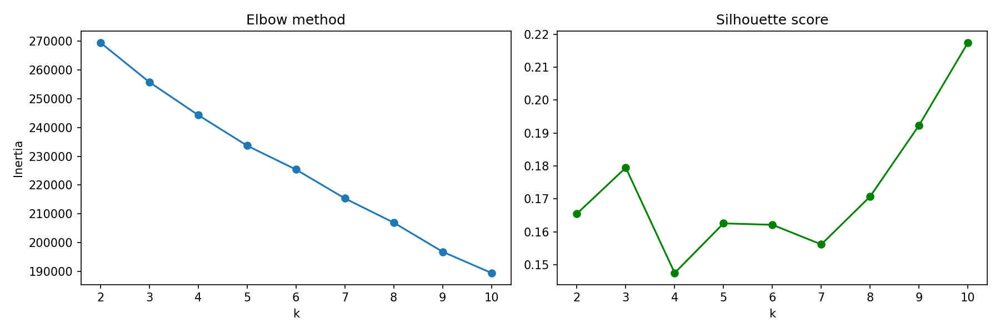
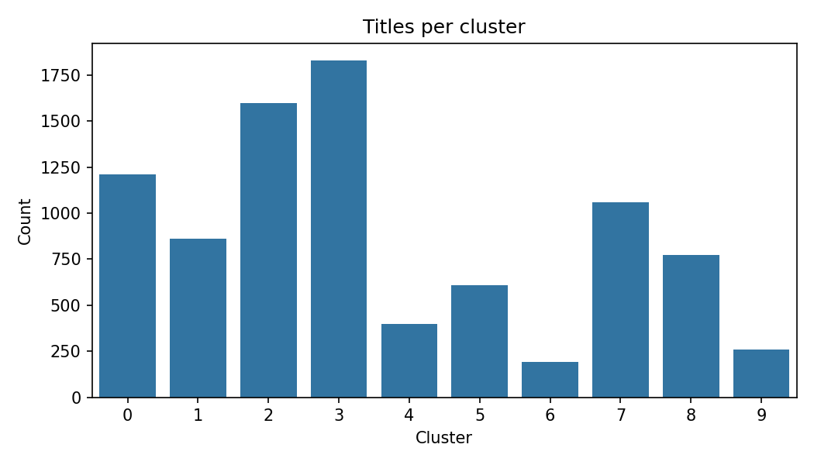
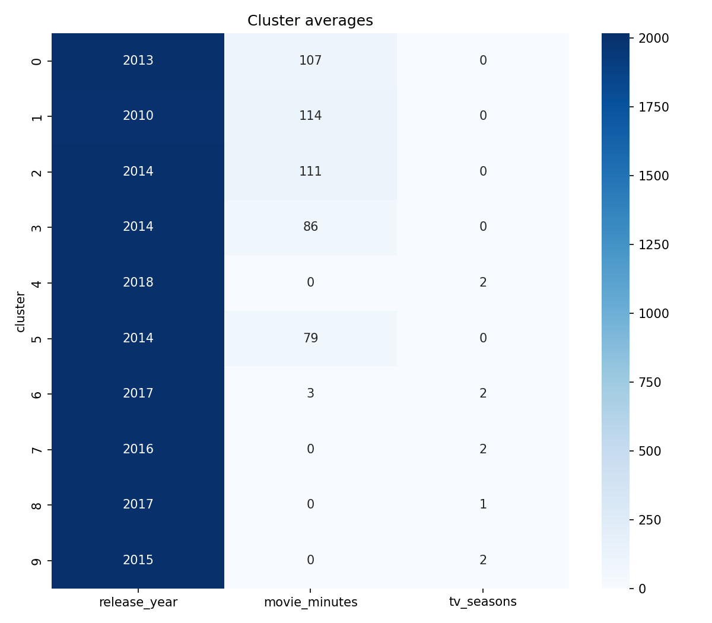
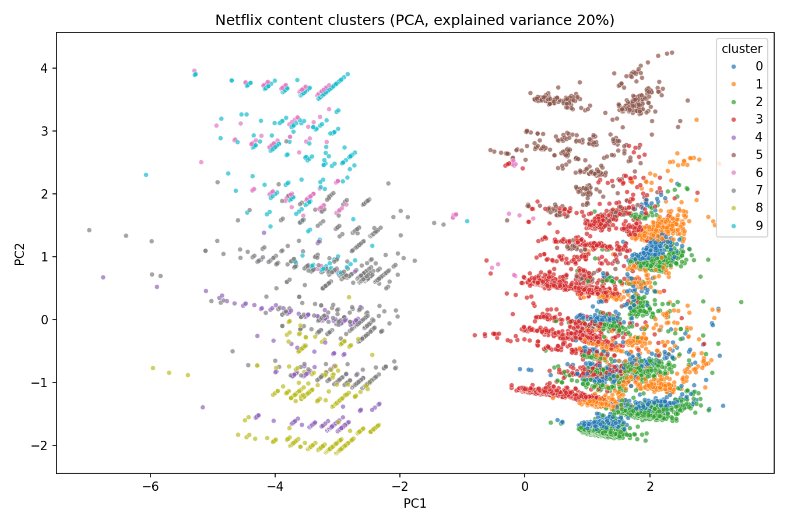

# Task 4 Report: Netflix Content Segmentation

## 1. Objective
Group Netflix titles into meaningful clusters using unsupervised learning, then describe what each cluster contains.

## 2. Data and features
The dataset has 8,790 titles and 10 columns. Missing ratings were set to "Unknown" and missing countries to "Unknown".

- Numerical: `release_year`, `movie_minutes` (duration of movies), `tv_seasons` (number of seasons of TV shows). Missing values were filled with the median.
- Categorical: `type`, `rating`, `main_genre` (first genre in `listed_in`, top 8 kept, rest "Other") and `main_country` (first country, top 6 kept, rest "Other").
- The categorical columns were one-hot encoded, giving 35 features, and all features were standardized with StandardScaler.

## 3. Choosing k
K-Means was run for k = 2 to 10. The elbow curve falls steadily with no sharp bend, so it does not point to one value. The silhouette score was highest at k = 10 (0.217), so k = 10 was used.

## 4. Clusters

| Cluster | Titles | Avg year | Movie min | TV seasons | Top rating | Top genre | Top country | Name |
|---|---|---|---|---|---|---|---|---|
| 0 | 1,210 | 2013 | 107 | 0 | TV-MA | Comedies | Other | Mature comedy movies |
| 1 | 859 | 2010 | 114 | 0 | R | Action & Adventure | United States | Older R-rated US action movies |
| 2 | 1,599 | 2014 | 111 | 0 | TV-MA | Dramas | Other | Mature drama movies |
| 3 | 1,830 | 2014 | 86 | 0 | TV-MA | Other | United States | Short US movies, less common genres |
| 4 | 399 | 2018 | 0 | 1.7 | TV-MA | Crime TV Shows | Other | Recent international crime TV |
| 5 | 609 | 2014 | 79 | 0 | PG | Children & Family Movies | United States | PG US family movies |
| 6 | 193 | 2017 | 3 | 1.7 | TV-Y | Kids' TV | United States | Kids' TV, youngest viewers |
| 7 | 1,057 | 2016 | 0 | 2.0 | TV-MA | Other | United States | US mature TV series |
| 8 | 773 | 2017 | 0 | 1.3 | TV-MA | International TV Shows | Other | International mature TV shows |
| 9 | 261 | 2015 | 0 | 2.0 | TV-Y7 | Kids' TV | United States | Kids' TV, older children |

## 5. Visualization
The PCA plot shows a clear split between movies (right) and TV shows (left). Inside each side the clusters overlap more.

## 6. Interpretation
- Five clusters (0, 1, 2, 3 and 5) are movies. They differ mainly by rating, genre and length: R-rated action is the oldest and longest, PG family movies are the shortest, and TV-MA comedies and dramas are the biggest mature groups.
- Five clusters (4, 6, 7, 8 and 9) are TV shows, split by audience (kids vs mature) and genre (crime, international).
- Kids' content separates into two groups by rating: TV-Y and TV-Y7.
- TV shows are newer on average (2015 to 2018) than movies (2010 to 2014).

## 7. Limitations
- The silhouette score of 0.217 means the clusters overlap and are only moderately separated.
- The first two PCA components explain only about 20% of the variance, so the 2D plot hides a lot of structure.
- The best silhouette was at the largest k tested (10), so a larger k might score higher.
- "Other" groups many small genres and countries together, so clusters 3 and 7 are less specific.

## 8. Conclusion
K-Means with k = 10 split the Netflix catalogue into interpretable groups by type, audience rating, genre and length. The strongest separation is movies versus TV shows, then kids versus mature content.

---
GitHub repository: https://github.com/Hoyoshedah/Netflix-Content-Segmentation
